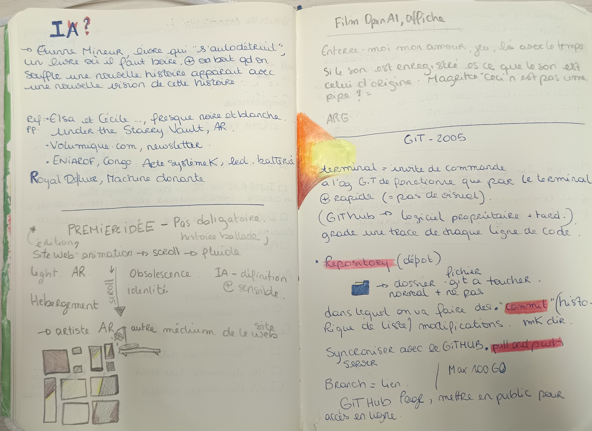

# Fiche Pédagogique

## Informations étudiant·e

- **Nom : Vannier-limodin**

- **Prénom : Margot**

## Profil et connaissances

### Présentation personnelle

// Décrivez en quelques phrases vos objectifs à court terme et à long terme, si vous en avez :

### Compétences

**CODE CRÉATIF**

**GIT ET VERSIONING**

**INTERACTIVITÉ ET RENDU TEMPS RÉEL**

**INSTALLATION ET MISE EN ESPACE**

**PRÉSENTATION ET ARGUMENTATION**

## Projets

### Projet 1

#### Sujet du projet

- **Titre du projet :**
- **Description du projet (environ 150 mots) :**

#### Thématiques de recherche

- **Thématiques que vous souhaitez explorer :**
- **Pourquoi cette thématique vous intéresse-t-elle ? (environ 100 mots) :**

#### Outils et techniques

- **Outils que vous comptez utiliser (logiciels, langages de programmation, etc.) :**
- **Techniques spécifiques que vous souhaitez maîtriser ou expérimenter :**

#### Références artistiques

- **Argumentaire expliquant la pertinence de votre projet (environ 150 mots) :**
- **Références artistiques qui inspirent votre travail (livres, artistes, œuvres, etc.) :**

## Actions

### Présentation orale d'un sujet artistique ou design (documentation de recherche)

// Sujet choisi, membres du groupe, date de passage et lien vers votre présentation :

### Accrochage de rendu

// Décrivez ce que vous allez présenter et comment vous comptez le mettre en espace :

### Contribution au logiciel

// Décrivez votre participation à la conception de l'outil commun et votre réflexion sur le sens du logiciel :

## Planification

### Planning de travail

- Établissez un planning des étapes clés de votre projet :
  - **Étape 1 :** date et description
  - **Étape 2 :** date et description
  - **Étape 3 :** date et description

## Commentaires et questions

// Avez-vous des questions ou des préoccupations à propos du cours ou de vos projets ? :

## Journal de bord

Ajoutez une entrée à chaque jour de cours, la plus récente en haut.

**JOUR 1 : 23/11/2026**

**Prise de note et premières idées**
 
**Photos premier croquis :**

 

prise en main de GitHub, assimilation de push and pull 

**Mots clés**

AR - Intéraction - jeu - IA - 
chercher a rendre l'ar plus intéracctif, aller plus loin que l'"activation" de vidéo/gif. 
comment faire?
trouver des references cohérentes et pertinente avec ma vision de cette pratique.

**JOUR 2 : 24/11/2026**

- **Ce que j'ai fait :**

En explorant de nombreux sites internets à la recherche de références sur la réalité augmentée et l'intelligence artificielle(webographie des plus intéréssant en fin de journée) j'ai décidé de me recentrer sur un travail de recherche, de documentation et de reflexion sur l'avenir de notre relation avec L'IA.
Grâce notament a institute Futur of life qui, de facon tres optimiste, essais de populariser une ia plus éthique, qui dans un monde moins capitaliste pourrait nous permettre d'ameliorer considerablement notre quotidien (soin de maladie incurable, avancées scientifique majeurs,...)

Reflexions (pas structurée)
 
Les humains ont toujours chercher à simplifier leur quotidien dès le début de l’humanité mais c’est peut être ce qui causera aussi sa perte…
l’ia, l’ia generative, l’ia analytique et j’en passe sont des outils formidables sur le papier; elles nous permettent de nous libérer de tâche ingrates, redondantes et pénibles.  

Mais n'est ce pas ce qui caractérise l’homme, réfléchir penser trouver des solutions, ou bien ne pas en trouver et partir sur autre chose puis finalement trouver et revenir sur notre idée de départ. C’est peut être ces cheminements de penser qui font de nous des être humain à part entière différents et uniques les uns des autres. 

Apres discution je me suis mise a lire les tutoriels de création d'AR sur Unity. partie qui est pour le moment encore a travailler.

forme finale idee :  édition pour mettre en page mes futures recherches + AR à l'intérieur, jeu de piste ? à revoir et perfectionner

- **Problèmes rencontrés :**

Problème de compatibilité unity template AR avec mon PC personel. 
obligation d'avancer sur les ordinaeur de l'école

- **Prochaine étape :**

Faire des tests de Réalité augmenté simple sur Unity pour ensuite amener à de simples interractions.
- **Captures / liens :**

Futur of life institut, https://futureoflife.org/fr/ 

tomorrows IA, sous-projet de l'institut Futur of life, essais de voir la possibilité d'un monde vivable positif avec l'ia  https://www.tomorrows-ai.org/

deux projets AR :

https://interactive.keepthefuturehuman.ai/

https://sensusart.rixc.org/

arte video IA création ultime de l'homme ? lien https://www.arte.tv/fr/videos/128061-000-A/intelligence-artificielle-l-ultime-invention-humaine/

tuto Unity AR  
https://docs.unity3d.com/Packages/com.unity.template.ar-mobile@1.1/manual/index.html
https://learn.unity.com/tutorial/configure-your-ar-development-environment?signup=true

photos carte mentale du projet à ajouter

### JJ/MM/AAAA

- **Ce que j'ai fait :**
- **Problèmes rencontrés :**
- **Prochaine étape :**
- **Captures / liens :**
