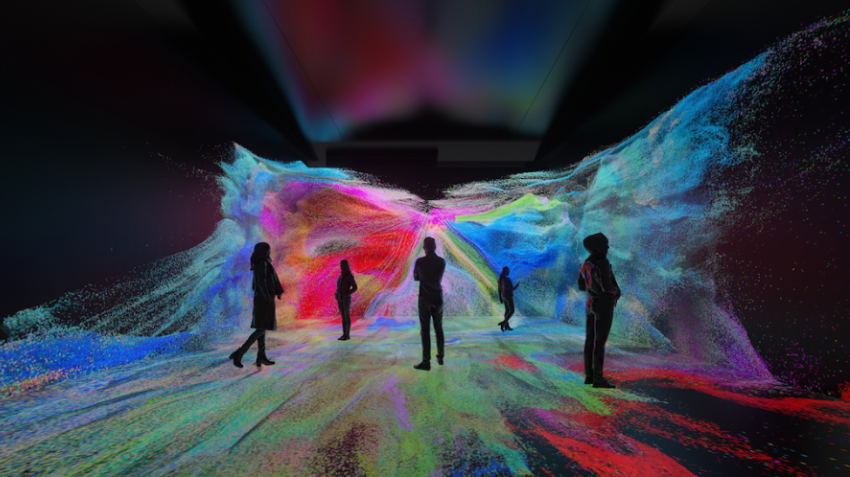
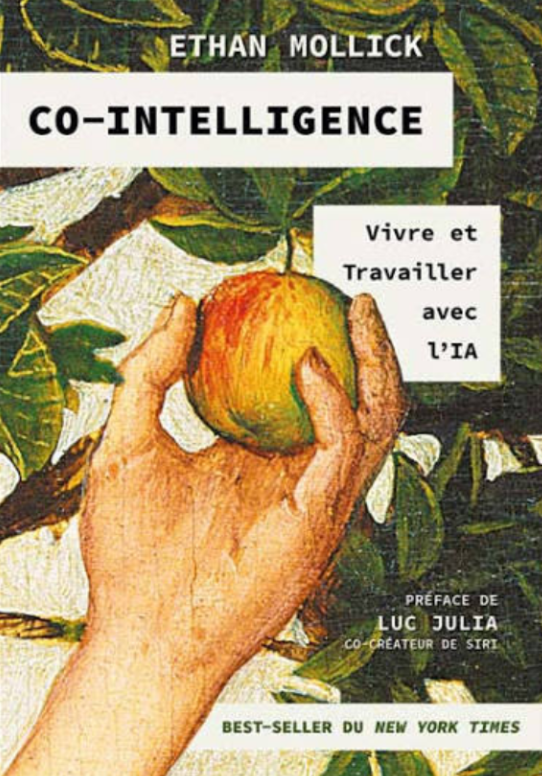
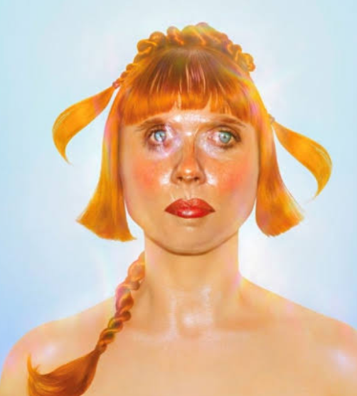
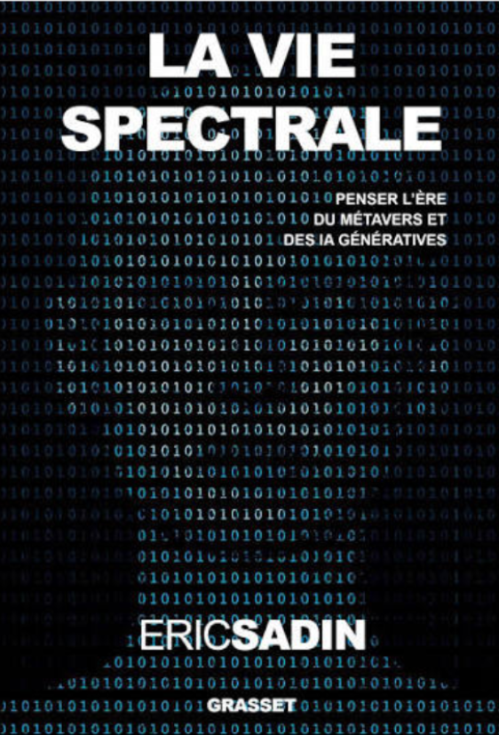
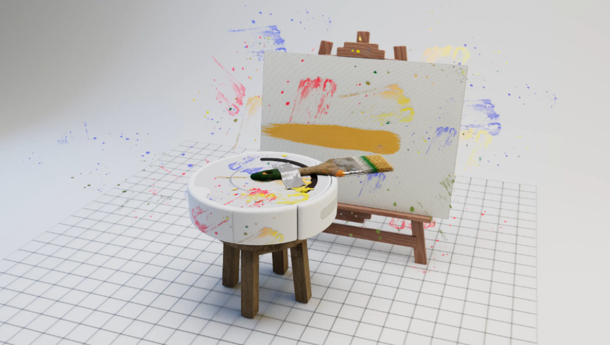
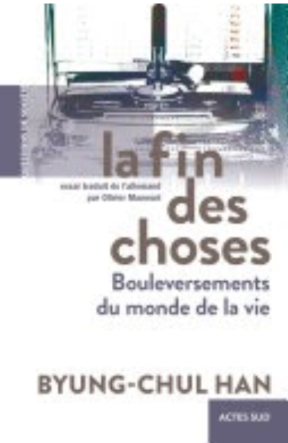

# Fiche Pédagogique

## Informations étudiant·e

- **Nom : Vannier-limodin**

- **Prénom : Margot**

## Profil et connaissances

### Présentation personnelle

// Décrivez en quelques phrases vos objectifs à court terme et à long terme, si vous en avez :

### Compétences

**CODE CRÉATIF**

**GIT ET VERSIONING**

**INTERACTIVITÉ ET RENDU TEMPS RÉEL**

**INSTALLATION ET MISE EN ESPACE**

**PRÉSENTATION ET ARGUMENTATION**

## Projets

### Projet 1

#### Sujet du projet

- **Titre du projet :**
- **Description du projet (environ 150 mots) :**

#### Thématiques de recherche

- **Thématiques que vous souhaitez explorer :**
- **Pourquoi cette thématique vous intéresse-t-elle ? (environ 100 mots) :**

#### Outils et techniques

- **Outils que vous comptez utiliser (logiciels, langages de programmation, etc.) :**
- **Techniques spécifiques que vous souhaitez maîtriser ou expérimenter :**

#### Références artistiques

- **Argumentaire expliquant la pertinence de votre projet (environ 150 mots) :**
- **Références artistiques qui inspirent votre travail (livres, artistes, œuvres, etc.) :**

## Actions

### Présentation orale d'un sujet artistique ou design (documentation de recherche)

// Sujet choisi, membres du groupe, date de passage et lien vers votre présentation :

### Accrochage de rendu

// Décrivez ce que vous allez présenter et comment vous comptez le mettre en espace :

### Contribution au logiciel

// Décrivez votre participation à la conception de l'outil commun et votre réflexion sur le sens du logiciel :

## Planification

### Planning de travail

- Établissez un planning des étapes clés de votre projet :
  - **Étape 1 :** Semaine du 22/27 novembre - Recherches, documentation - AR Unity - maquettes -  
  - **Étape 2 :** Semaine du 30/4 decembre - Mise en plce de code et scénario/gameplay de l'application okay une intéraction par jour - AR - ébauche edition intéractive
  - **Étape 3 :** Semaine 7/12 decembre - dernière semaine - fin de mise en page et impression édition itéractive - réponse aux questions ou non bilan de fin d'intensifs et ouvertures.

## Commentaires et questions

// Avez-vous des questions ou des préoccupations à propos du cours ou de vos projets ? :

## Journal de bord

Ajoutez une entrée à chaque jour de cours, la plus récente en haut.

**JOUR 4** : am-27/11/2026 (mix 26/11/2026)

- **Ce que j'ai fait :**

Point philosophique fondamental : la valeur de l'effort cognitif et du tâtonnement.

En philosophie de la technique, ce que tu décris porte un nom : le risque de « prolétarisation » des savoirs (concept développé par Bernard Stiegler), c'est-à-dire le fait que l'outil ne se contente plus d'augmenter nos capacités physiques (comme la roue ou la grue), mais qu'il prend en charge notre faculté de juger, d'hésiter et de créer.

Tu soulignes avec justesse que l'erreur, le détour et l'impasse ne sont pas des « bugs » de la pensée humaine, mais son moteur même. C'est souvent en cherchant une solution A qu'on découvre par hasard une idée B bien plus féconde (la sérendipité). Si l'IA nous livre instantanément un résultat lisse et optimisé, elle risque d'atrophier ce muscle de la recherche intérieure. Ton texte a donc une vraie justesse : il pose la question de savoir si l'humain se définit par le résultat qu'il produit ou par le chemin qu'il emprunte pour y arriver.

→ jeu AR sans concrétisation finale a première vue ??

Regards positifs : L'IA comme amplificateur et partenaire de création
Plusieurs penseurs, artistes et chercheurs voient dans l'IA non pas un remplaçant, mais un « exosquelette cognitif » ou un nouveau pinceau qui déplace la créativité humaine plutôt que de la détruire.

Refik Anadol (Artiste numérique) :

 Il utilise des algorithmes d'IA pour transformer d'immenses bases de données (archives de la NASA, souvenirs humains, données climatiques) en « sculptures de données » monumentales et poétiques. Pour lui, l'IA est un « pinceau pensant » qui permet de visualiser l'invisible et de créer une nouvelle forme d'empathie collective.
 

Ethan Mollick (Chercheur à Wharton, auteur de Co-Intelligence) : Dans cet ouvrage de référence (2024), il défend l'idée d'une intelligence hybride. Selon lui, la meilleure façon d'utiliser l'IA n'est pas de lui déléguer le travail, mais de l'utiliser comme un « sparring-partner » intellectuel qui nous force à affiner nos propres idées en confrontant nos points de vue aux siens.

 

Holly Herndon (Musicienne et chercheuse) : Elle a créé Spawn, un « bébé IA » entraîné sur sa propre voix, avec lequel elle compose en duo. Elle milite pour une approche où les artistes entraînent leurs propres modèles éthiques pour explorer des territoires sonores impossibles à atteindre seuls.
 

Yann LeCun (Chercheur en IA) : Il rappelle souvent que l'IA actuelle manque de bon sens et de compréhension du monde physique. Il la voit comme un outil qui va libérer l'humanité des tâches répétitives pour ouvrir une « nouvelle Renaissance » scientifique et culturelle.

 

Regards critiques : Le risque d'uniformisation et de perte de sens
Pour nuancer ta réflexion, d'autres voix alertent précisément sur ce que tu redoutes : l'appauvrissement de la pensée humaine et la standardisation du monde.

Éric Sadin (Philosophe français) : Dans des essais comme La Vie spectrale (2023), il dénonce le basculement vers une « humanité assistée ». Selon lui, en déléguant la parole, l'écriture et la décision à des systèmes génératifs, nous renonçons à notre souveraineté intellectuelle et à la singularité de notre rapport au monde. 

 

Ted Chiang (Écrivain de science-fiction) : Dans des essais très remarqués pour le New Yorker (notamment « Why A.I. Isn’t Going to Make Art »), il explique que l'art et l'écriture consistent à faire des milliers de micro-choix conscients. Utiliser une IA générative, c'est renoncer à ces choix et donc vider l'œuvre de son intention humaine. https://www.newyorker.com/culture/the-weekend-essay/why-ai-isnt-going-to-make-art
 

Byung-Chul Han (Philosophe) : Bien qu'il écrive plus largement sur le numérique, sa critique de la « société de la transparence et de la performance » éclaire ton propos : le numérique élimine la négativité, l'attente et la résistance du réel, qui sont pourtant indispensables à la maturation de la pensée profonde.

Ressources pour nourrir réflexion

À lire :

Essai : Co-Intelligence : Vivre et travailler avec l'IA d'Ethan Mollick (très concret et optimiste sur la collaboration homme-machine).

Article : « Why A.I. Isn't Going to Make Art » de Ted Chiang (publié dans The New Yorker, accessible en ligne — une analyse chirurgicale sur le rôle du cheminement créatif).

Essai critique : La Vie spectrale : Penser l'ère du métavers et des IA génératives d'Éric Sadin.

À voir (Films et documentaires) :

Her (Spike Jonze, 2013) : Un film visionnaire sur la relation intime, émotionnelle et créative entre un homme (dont le métier est d'écrire des lettres sensibles pour les autres) et une IA.

AlphaGo (Greg Kohs, 2017) : Ce documentaire raconte l'affrontement entre l'IA de DeepMind et le champion du monde de Go, Lee Sedol. Le « coup 37 » joué par la machine a bouleversé les joueurs humains, leur montrant que l'IA pouvait inspirer de nouvelles façons de penser plutôt que simplement écraser l'humain.

After Yang (Kogonada, 2021) : Un film contemplatif et poétique qui interroge la mémoire, la transmission et ce qui fait la valeur d'une existence à travers un androïde familial en panne.

À écouter / regarder en vidéo :

Les conférences TED de Refik Anadol sur l'art généré par les données (« Art in the age of machine intelligence »).

Les interventions de Raphaël Enthoven ou Gaspard Koenig sur France Culture autour de la question : « L'IA peut-elle penser ou seulement calculer ? ».
Si tu souhaites approfondir un angle précis de ton texte (par exemple la question de la créativité artistique, celle du travail ou l'aspect purement philosophique), on peut creuser ensemble.

- **Problèmes rencontrés :**
Trouver concept plus concret, et mécanisme de jeux lien humain-AI

- **Prochaine étape :**
Ce week-end, blender premier modèle 3D,
finir web site code intéraction humaine

- **Captures / liens :**

**JOUR 3** : pm-25/11/2026

- **Ce que j'ai fait :**

Retour sur le tuto AR Unity, installation du débogage mode USB sur mon téléphone. Créations de l'application AR-Unity puis première tentative avec les formes de bases donnée dans l'application 

Cours prise de note RAM-CPU-GPU :

discution avec Ange pour son projet

Recherche et Compréhenssion du MCP server, son utilitée, quelle IA est la plus qualifiée pour m'aider à approfondir mes recherches et expérimentations

- **Problèmes rencontrés :**

Quelques soucis de prise en main pour une première, qui devrait ce régler d'ici la fin de semaine en continuant la documentation sur internet (tuto vidéo, écrit).

- **Prochaine étape :**

Me fixer sur idée plus concrète de ce que je veux faire - peut etre réaliser un jeu simple qui sera plus tard compatible AR mais pour l'instant tester les interactions avec les quelles je souhaite explorer l'AR interactif ! (cela me permettra egalement de coder et de me faire une premiere idée du rendu visuel que cela peut donner) (surtout week-end 28-29/ nov)

**JOUR 2 : 24/11/2026**

- **Ce que j'ai fait :**

En explorant de nombreux sites internets à la recherche de références sur la réalité augmentée et l'intelligence artificielle(webographie des plus intéréssant en fin de journée) j'ai décidé de me recentrer sur un travail de recherche, de documentation et de reflexion sur l'avenir de notre relation avec L'IA.
Grâce notament a institute Futur of life qui, de facon tres optimiste, essais de populariser une ia plus éthique, qui dans un monde moins capitaliste pourrait nous permettre d'ameliorer considerablement notre quotidien (soin de maladie incurable, avancées scientifique majeurs,...)

Reflexions (pas structurée)
 
Les humains ont toujours chercher à simplifier leur quotidien dès le début de l’humanité mais c’est peut être ce qui causera aussi sa perte…
l’ia, l’ia generative, l’ia analytique et j’en passe sont des outils formidables sur le papier; elles nous permettent de nous libérer de tâche ingrates, redondantes et pénibles.  

Mais n'est ce pas ce qui caractérise l’homme, réfléchir penser trouver des solutions, ou bien ne pas en trouver et partir sur autre chose puis finalement trouver et revenir sur notre idée de départ. C’est peut être ces cheminements de penser qui font de nous des être humain à part entière différents et uniques les uns des autres. 

Apres discution je me suis mise a lire les tutoriels de création d'AR sur Unity. partie qui est pour le moment encore a travailler.

forme finale idee :  édition pour mettre en page mes futures recherches + AR à l'intérieur, jeu de piste ? à revoir et perfectionner

- **Problèmes rencontrés :**

Problème de compatibilité unity template AR avec mon PC personel. 
obligation d'avancer sur les ordinaeur de l'école

- **Prochaine étape :**

Faire des tests de Réalité augmenté simple sur Unity pour ensuite amener à de simples interractions.

- **Captures / liens :**

Futur of life institut, https://futureoflife.org/fr/ 

tomorrows IA, sous-projet de l'institut Futur of life, essais de voir la possibilité d'un monde vivable positif avec l'ia  https://www.tomorrows-ai.org/

deux projets AR :

https://interactive.keepthefuturehuman.ai/

https://sensusart.rixc.org/

arte video IA création ultime de l'homme ? lien https://www.arte.tv/fr/videos/128061-000-A/intelligence-artificielle-l-ultime-invention-humaine/

tuto Unity AR  
https://docs.unity3d.com/Packages/com.unity.template.ar-mobile@1.1/manual/index.html
https://learn.unity.com/tutorial/configure-your-ar-development-environment?signup=true

photos carte mentale du projet à ajouter

**JOUR 1 : 23/11/2026**

**Prise de note et premières idées**
 
**Photos premier croquis :**

 

prise en main de GitHub, assimilation de push and pull 

**Mots clés**

AR - Intéraction - jeu - IA - 
chercher a rendre l'AR plus intéractif, aller plus loin que l'"activation" de vidéo/gif. 
comment faire ?
trouver des ré  ferences cohérentes et pertinente avec ma vision de cette pratique.

### JJ/MM/AAAA

- **Ce que j'ai fait :**
- **Problèmes rencontrés :**
- **Prochaine étape :**
- **Captures / liens :**
